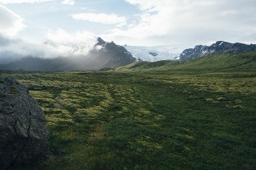
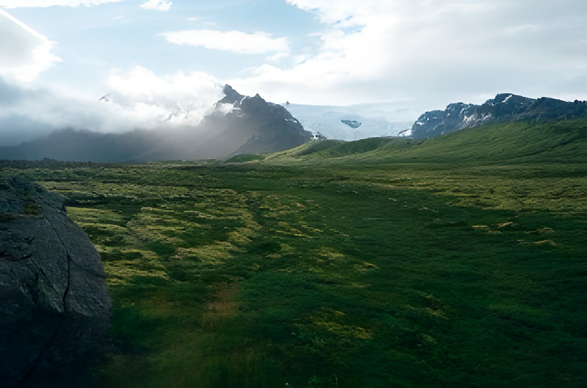

<div align="center">

# HDify

**Turn photos into HD, right in your browser.**

Private, free and open source. Powered by WebGPU. Nothing is uploaded.

**[Try it now: dhee2211.github.io/HDify](https://dhee2211.github.io/HDify/)**

[](LICENSE)

[](CONTRIBUTING.md)

</div>

## Features

- **Sharper and bigger.** Enhance photos 2× or 4×, or target Full HD or 4K.
- **Private by design.** Your photos are processed on your own device and never leave it.
- **Fast on the GPU.** Uses WebGPU through ONNX Runtime Web, with a slower CPU fallback.
- **Face restoration.** Finds faces and rebuilds them with RestoreFormer++, then blends them back in. The 71 MB face model only downloads when a face is found.
- **Before and after.** Drag the slider to compare, and use the Strength slider to dial the enhancement up or down.
- **No install, no backend.** A static site with no build step and no dependencies to install.

## How it works

HDify runs the [Real-ESRGAN](https://github.com/xinntao/Real-ESRGAN) super-resolution model in your browser.
Large photos are split into 256 px tiles (with overlap to hide seams), enhanced one by one, and stitched back together.

With **Restore faces** on, [YuNet](https://github.com/opencv/opencv_zoo/tree/main/models/face_detection_yunet) finds faces, each one is aligned to a 512 px template, rebuilt by [RestoreFormer++](https://github.com/wzhouxiff/RestoreFormerPlusPlus), and blended back into the enhanced photo with a soft mask.

Models download from Hugging Face the first time they are needed: Real-ESRGAN (about 67 MB), plus the face detector (0.2 MB) and the face model (about 71 MB) only when a face is found. Every download is pinned to a specific revision, its SHA-256 checksum is verified, and it is cached in your browser, so later runs start instantly.

## Examples

Each photo was shrunk to a quarter of its size, then enhanced 4× by HDify. The portraits also used face restoration.

<table>
<tr>
<td align="center"><br><sub>Input (320 px)</sub></td>
<td align="center"><br><sub>HDify (1280 px)</sub></td>
</tr>
<tr>
<td align="center"><br><sub>Input (320 px)</sub></td>
<td align="center"><br><sub>HDify + face restoration (1280 px)</sub></td>
</tr>
</table>

More examples with before/after sliders are on the [live site](https://dhee2211.github.io/HDify/#examples). Photo credits are in [examples/CREDITS.md](examples/CREDITS.md).

## Run it

You need a recent browser with WebGPU (Chrome or Edge 113+, or Safari 26+) and Python 3 or any static file server.

```bash
git clone https://github.com/Dhee2211/HDify.git
cd HDify
npm start        # or: python3 -m http.server 8000
```

Open http://localhost:8000 and drop in a photo.

> ES modules don't load from `file://`, so open the app through a local server rather than double-clicking `index.html`.

## Development

```bash
npm test         # unit tests for tiling and face helpers (Node 18+)
```

| File | Role |
| --- | --- |
| `index.html`, `style.css` | Interface |
| `app.js` | Model loading, WebGPU inference, tile pipeline, UI logic |
| `tile.js` | Pure tiling and scale-planning helpers (unit-tested) |
| `face.js` | Pure face helpers: detector decoding, alignment math (unit-tested) |
| `examples/` | Example photos and credits |
| `test/` | Tests |

## Limits

- Output is capped at about 64 megapixels to stay within browser memory.
- Transparent images are flattened onto white.
- Face restoration handles up to 10 faces, found on a 640 px view of the photo, so very small faces in large group shots can be missed.
- Face restoration smooths skin slightly, and heavily compressed faces can look blotchy. Use the Strength slider to dial it back.
- Without WebGPU it falls back to the CPU, which is much slower.

## Roadmap ideas

- Batch mode
- Photo-specific model options (denoise strength, anime model)
- JPEG and WebP export
- Installable PWA with offline support

## Contributing

Contributions are welcome.

- [Request a feature](../../issues/new?template=feature_request.yml)
- [Report a bug](../../issues/new?template=bug_report.yml)
- [Read the contributing guide](CONTRIBUTING.md)

## Licenses

HDify is released under the [MIT License](LICENSE). Third-party components and their licenses are listed in [NOTICE.md](NOTICE.md).
